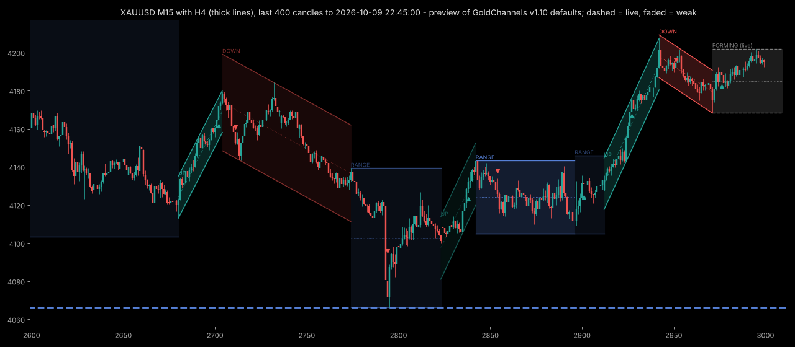

# Gold Channels for MT5 (v1.10)

`GoldChannels.mq5`: an MT5 indicator that cuts the chart into stretches and labels each one as an **uptrend**, a **downtrend** or a **range**, with its channel drawn around it. It also draws the higher timeframe's channels on top. It works on any timeframe and any symbol, and the defaults were set on XAUUSD.

The two images in `img/` were drawn from your exported candles (M15 with H4 on top, and H1 with D1 on top, up to 9 Oct 2026) with the same rules and default settings, so you know what to expect. MT5 itself will look a little different.

## New in v1.10

1. **Higher timeframe on the same chart.** Its channels are drawn as thick lines with no shading, labelled with the timeframe, for example "H4 UP". By default you get H1 on M1-M5, H4 on M15-M30, D1 on H1-H4 and W1 on D1. The second line of the corner summary shows its live stretch.
2. **Fewer false breaks.** A break now needs 2 closes in a row outside the band on the same side. One spike candle no longer ends a channel.
3. **Channel quality.** A channel is **strong** when each line was touched at least twice, as separate swings, and a trend's closes also follow its line closely (R² at least 0.6). Weak channels are drawn faded. Hover over a channel, or read the corner summary, to see its touches and R².
4. **Touch alerts.** You get an alert when price reaches the live channel's upper or lower line (within 5% of the channel width). It fires at most once per candle for each line, and the phone app can get it too.
5. **Settings that fit the timeframe.** The shortest stretch is now 60 candles on M1, 40 on M5, 30 on M15, 25 on M30 and 20 on H1 and above, unless you set your own.

## Install

1. In MT5, go to File > Open Data Folder > MQL5 > Indicators and copy `GoldChannels.mq5` there, replacing the old one.
2. Open it in MetaEditor and press F7 to compile. Paste any errors in the thread. A C++ translation of it compiles with no errors. Fed the last 6,000 H1 candles one at a time, as MT5 does, it gave exactly the same 201 stretches and breaks as the Python prototype, and the same 105 stretches on D1 for the higher timeframe.
3. Drag "GoldChannels" from the Navigator onto a chart.

## How to read it

- **Green channel, "UP":** an uptrend. **Red channel, "DOWN":** a downtrend. **Blue box, "RANGE":** a range, running from the stretch's highest high to its lowest low.
- The **channel lines** run parallel to a straight line fitted through the stretch's closes, and they touch the stretch's most extreme high and low. The dotted line is the middle.
- **Bright** channels are strong, **faded** ones are weak.
- **Thick lines** with a timeframe in the label, such as "D1 DOWN", are the higher timeframe's channels.
- **Arrows** mark the candle whose close confirmed a break: up for a break above, down for a break below.
- **Dashed channel, "(live)":** the newest stretch. The chart's own live channel is carried 10 candles to the right, and the higher timeframe's 2 of its candles, so you can see where the lines are heading. A grey "FORMING" box means the live stretch is still too short to call.
- **Bottom-right corner:** one line for the chart's live stretch and one for the higher timeframe's. Each shows the label, start time, the channel or box right now, and whether it is strong or weak.
- Hover over any line to see the stretch's numbers.

## What is fixed and what can still change

"Perfect" channels are only possible in hindsight, so this is exactly how much hindsight the indicator uses:

- **Everything before the live stretch is fixed.** Each break is decided at a candle's close, using only candles that had already closed. The forming candle is never used. Old stretches don't move when new candles arrive.
- **The live (dashed) stretch can still change.** Its line, channel width, label and quality are refitted on every new candle. A stretch can start as a range and become an uptrend as it grows, or the other way round.
- **When a break is confirmed**, the live stretch ends. Its end moves back to the swing that started the break: the lowest low of the last "shortest stretch" candles for a break up, or the highest high for a break down. The new stretch starts at that swing. So the arrow sits a few candles after the point where the new stretch begins. From then on the old stretch is fixed for good.
- **The higher timeframe works the same way**, but on its own candles. Its live channel only changes when one of its candles closes, for example every 4 hours for H4.
- The fit starts at the oldest of the last 3,000 candles. Reloading the chart or changing the history setting can change the first one to three stretches. Everything after that comes out the same.
- **Touch alerts use the live price**, so they react within the candle. They are about the live channel, which can still move.

## How a stretch ends

A stretch ends when 2 candles in a row close beyond its band on the same side. The band is the fitted line plus or minus 2 standard deviations of the closes around that line, plus 0.2 ATR. The band is fitted on the candles before those two closes, and a stretch must be at least "shortest stretch" candles long before it can break.

A stretch is a **trend** when its fitted line rises or falls by at least 0.6 times the channel's width over the stretch. Otherwise it is a **range**.

## Settings

| Setting | Default | What it does |
|---|---|---|
| Shortest stretch | 0 = by timeframe | 60 candles on M1, 40 on M5, 30 on M15, 25 on M30, 20 on H1 and above. Set a number to use it on every timeframe. It is also how far back the swing is looked for at a break |
| Closes to confirm a break | 2 | 1 is v1.00's behaviour. 3 gives even fewer, later breaks |
| Band (standard deviations) | 2.0 | How far closes must go beyond the fitted line to end a stretch. Higher means fewer breaks |
| Buffer (ATR) | 0.2 | Extra distance on top of the band |
| ATR period | 14 | Used only for that buffer |
| Trend strength | 0.6 | Rise or fall over the stretch divided by the channel width. Raise it to call fewer trends and more ranges |
| History | 3,000 candles | How far back the chart is cut into stretches. The higher timeframe uses the same number of its own candles |
| Fade weak channels | On | Off draws every channel bright |
| Touches for a strong channel | 2 | Separate touches each line needs. A run of candles touching it counts once |
| Touch distance | 20% | A candle "touches" a line when it comes within this share of the channel width |
| R² for a strong trend | 0.6 | How closely the closes must follow a trend's line (1 = perfectly straight) |
| Show higher timeframe | On | Draws the higher timeframe's channels |
| Higher timeframe | Current = automatic | Pick one yourself, for example D1 on an M15 chart. It must be higher than the chart's |
| Extend its live channel | 2 candles | Of the higher timeframe |
| Touch alerts | On | Alert when price reaches the live channel's upper or lower line. Not while it is "FORMING" |
| Alert distance | 5% | How close to the line, as a share of the channel width, counts as reaching it |
| Break alerts | Off | Alert when a break is confirmed |
| Phone alerts | Off | Also send alerts to the MT5 phone app (set up under Tools > Options > Notifications) |
| Trend channel width | Touch extremes | Or "Fitted line +- the band", which gives a tighter channel that some wicks poke through |
| Flat ranges | On | Ranges are drawn as flat boxes. Turn it off to draw them as nearly flat channels instead |
| Shade / shade strength | On, 22% | MT5 has no transparency, so the shading is mixed with your chart's background colour. If you change the background, reload the indicator |
| Middle line, labels, arrows | On | Turn them off for a cleaner chart |
| Extend the live channel | 10 candles | 0 stops the live channel at the last closed candle |
| Name of this copy | GCH1 | To run two copies on one chart, give each a different name |

The first time you open a chart, MT5 may still be downloading the higher timeframe's history. The corner then says "loading history...", and the indicator keeps trying every 2 seconds.

## Is it a trading signal? Still no

I re-ran the break test with the v1.10 settings, which were picked by looking at charts and never tuned on profit. The test went long on a break up, went short (or flat, for long only) on a break down, held until the opposite break, filled at the next candle's open, and paid $0.40 per trade plus swap, on 0.01 lot. The second test only took a long when the higher timeframe's live stretch was UP, and a short when it was DOWN.

| Timeframe, period | Breaks, long and short | Breaks, long only | Only with the higher timeframe, long and short | Holding gold |
|---|---|---|---|---|
| H4, Oct 2013 to Oct 2026 | -$379 | +$1,145 | +$324 (D1) | about +$2,880 |
| H1, Jul 2016 to Oct 2026 | +$1,729 | +$2,229 | +$859 (D1), worst drop $265 | about +$2,850 |
| M15, Jul 2022 to Oct 2026 | +$1,479 (2 of 5 years up) | +$1,940 | +$1,138 (H4), worst drop $343 | about +$2,450 |
| M5, May 2025 to Oct 2026 | +$777 | +$840 | +$1,218 (H1), worst drop $300 | about +$950 |

The v1.10 settings (2 closes to confirm, and longer stretches on M15 and M5) turned v1.00's M15 loss of $2,853 into a profit. Following the higher timeframe cuts the worst drawdown to about a third, but it also cuts the profit, except on M5. M5 is the only result that beats holding gold, at $2.33 a day, but it covers only 17 months of a rising market. Nothing here comes near the GoldAllAgree + GoldAsiaBreak pair at about $4.66 a day. Fewer than half of the trades win in most of the tests.

So treat GoldChannels as a way to see the market's structure: where the trend is on two timeframes, how good the channel is, and when it broke. It is not a reason to enter a trade by itself. Results: `signal_test.csv` and `htf_filter_test.csv`. Code: `code/signal_test.py` and `code/htf_filter_test.py`.

## Files

- `GoldChannels.mq5`: the indicator.
- `code/seg.py`: the same rules in Python (prototype). `code/preview.py` draws the preview images, and `code/signal_test.py` and `code/htf_filter_test.py` run the tests above.
- `review/compile/`: the C++ translation used to check the code (`to_cpp.py`, `mql5_shim.h`, `runtime.cpp`) and the comparison with Python (`parity.py`). Run `python3 to_cpp.py ../../GoldChannels.mq5 gch_as_cpp.cpp 120` to translate it.
