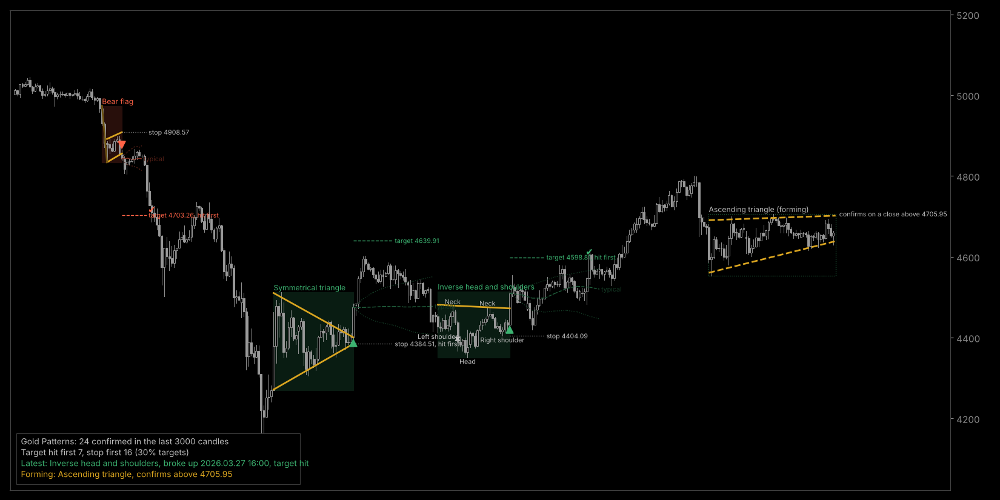
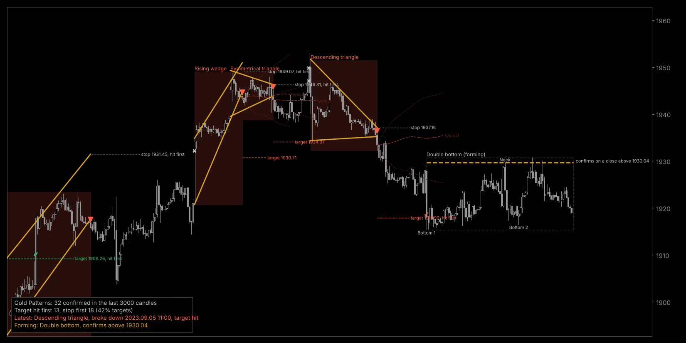

# GoldPatterns: chart patterns on your MT5 chart

`GoldPatterns.mq5` is an MT5 **indicator** (not an EA, it never places orders). It scans the chart, finds the same 23 chart patterns as the Gold Pattern Trainer app, and draws them.

*Previews made from the indicator's own drawing commands on real XAUUSD H1 data (March 2026 and September 2023). In MT5 it uses your chart's fonts and text colour.*

## Install

1. In MT5: File > Open Data Folder > `MQL5` > `Indicators`. Copy `GoldPatterns.mq5` there.
2. Open it in MetaEditor (double-click it in the Navigator, or right-click > Modify) and press **F7**. If it shows errors, paste them in this thread.
3. Back in MT5, drag **GoldPatterns** from Navigator > Indicators onto any chart. It works on every symbol and timeframe.
4. Turn on **chart shift** (the button with the small arrow at the right edge of the toolbar, or Charts > Chart Shift). Target, stop and "confirms on..." labels sit just right of the last candle and are hidden without it.

## What you see

- **Confirmed patterns**: a shaded box (green when it broke up, red when it broke down), the pattern lines in gold, the key points labelled (Top 1, Neck, Left shoulder, Head, Pole start, Cup bottom...), the name, and an arrow on the breakout candle.
- **Target and stop**: dashed target (the measured move, as in the app) and dotted stop, with prices.
- **What happened next**: a check mark where price reached the target first, or a stop sign where it hit the stop first; the target or stop label also says "hit first".
- **Forming patterns**: dashed lines and a dotted box, marked "(forming)", with the exact close that would confirm it on the next candle, e.g. "confirms on a close above 4705.95". Symmetrical triangles, rectangles and broadening patterns can break either way, so they show both prices.
- **Typical path** (new in 1.20): after the 3 most recent patterns, a faint dashed line and two dotted lines show what price usually did next on gold after that kind of pattern. The dashed line is the middle case and the dotted lines hold the middle half of cases. Hover over them for the numbers. See "Typical path" below.
- **Panel** (bottom left, movable): how many patterns were confirmed on this chart, how often the target came before the stop, the latest pattern, and anything forming now.

## Settings

| Setting | Default | What it does |
|---|---|---|
| Closed candles to scan | 3000 | How far back it looks |
| Pattern sizes | All | Small = swings of 1.5 and 2 ATR, Large = 3 and 4.5 ATR |
| Five group switches | on | Tops/bottoms and head and shoulders; triangles, rectangles, broadening; wedges and channels; flags and pennants; cups and rounding |
| Show forming patterns | on | Dashed patterns that have not broken out yet |
| Confirmed patterns to draw | 20 | Only the most recent ones, so the chart stays readable |
| Target and stop / outcome / key point labels / panel | on | Turn parts of the drawing off |
| Panel corner | bottom left | Bottom left keeps it clear of MT5's one-click trading buttons |
| Text colour | None | None follows your chart's text colour, so it reads on dark and light charts |
| Other colours, font size | | |
| Typical path | on | The faint lines after recent patterns |
| ...after this many recent patterns | 3 | |
| ...over this many pattern lengths | 1 | 0.25 to 2; longer paths fan out wider |
| Alert when confirmed | on | Pop-up when a candle closes and confirms a pattern |
| Alert when forming | off | Pop-up when a new pattern starts forming |
| Phone alerts | off | Also sends to the MT5 phone app (needs your MetaQuotes ID in Tools > Options > Notifications) |
| Object name prefix | GPAT | Change it if you put two copies on one chart |

## What can change on the chart

- It only reads **closed candles**, so nothing moves inside a candle. It recalculates once per new candle.
- A **forming** pattern can grow, change or disappear as candles close. That is normal: it has not happened yet.
- A **confirmed** pattern stays. I replayed all the gold history I have (D1 2004-2026, H4, H1, M15, M5, about 285,000 candles) one candle at a time: 2,536 patterns were confirmed and none of them later vanished or moved. The oldest ones drop off the left edge as new candles arrive, as with any indicator that scans a fixed number of candles.
- About 1 pattern in 10 appears a few candles **after** its breakout candle (5 on average). The breakout happened first, but the last swing of the pattern was only complete later. The arrow still sits on the breakout candle, the label's tooltip says when it was confirmed, and the alert says "broke down 3 candles ago at X, now Y".

## How it was checked

- No MetaEditor here, so it is uncompiled. I translated it line for line to C++ against stand-ins for the MT5 functions and compiled it with all warnings on: no errors, no warnings.
- On 60 random windows (D1, H4, H1, M15, M5), it found exactly the same patterns as the Python reference: 1,752 patterns, 0 differences. The reference matches the app's detector except for the fix below. The files are in `check/`.
- The candle-by-candle replay above gave about one confirmed-pattern alert per 100 candles.

## Changed in 1.20 (26 Oct)

- Added the typical path (above), with three settings.

## Changed in 1.10 (26 Oct)

- **No more vanishing double tops and bottoms.** In 1.00 a confirmed double top could disappear later if a third top formed after the breakout (it became a "triple top" in hindsight). The replay found 6 such cases. Now a third top only counts if it was already complete when the double top confirmed.
- **No more churn at the left edge.** It now reads 300 extra candles in front of the scan to settle the ATR and swings, and never draws patterns that start there.
- **Exact confirm prices.** "Confirms on a close above X" now includes the 0.1 ATR margin and, for flags, the latest candle's high or low, exactly as the detector checks it. 1.00 showed the bare line price.
- **Tidier labels.** The pattern name sits at the left edge, on the side away from the labelled points. The pole labels on flags are gone (the pole line stays). "Target hit" text became a check mark or stop sign plus "hit first" on the label.
- **Panel** moved to the bottom left with a background sized to the text, and a corner setting.
- **Text colour** follows the chart, so light charts work.
- **Alerts** for late confirmations say how many candles ago the breakout was and the current price. Forming alerts include the confirm price.
- The panel says "neither hit in time" instead of "still open" once the pattern's time window has passed.

## Typical path: what it is and what it isn't

You asked for something that predicts where a pattern goes. I measured what price actually did after 2,723 patterns found by this indicator on all my gold data (D1 2004-2026, H4, H1, M15, M5). For each one I recorded the path from its confirmation candle over two pattern lengths, in multiples of the distance to its target, so a pattern of any size fits the same scale. The indicator draws the middle and the middle half of those paths for that kind of pattern. Rare patterns (triple tops, head and shoulders, rectangles, cups and rounding) borrow the numbers of their group.

I built the paths from patterns up to 2023 and tested them on the 1,726 patterns from 2024-2026:

- **The range is realistic.** Price stayed inside the middle-half band 49% of the time, close to the 50% it should be. Use it to see how far price usually wanders and whether the target is a realistic distance away. For bull flags, for example, the band after one length only reaches about a third of the way to the target.
- **The direction is a coin flip.** Patterns moved their textbook way 48% of the time, against 50% for random entries in the same direction. The middle line was no closer to what happened than a flat line at the breakout price. Sorting by trend, momentum or volatility didn't help: what looked like an edge before 2024 reversed after it.
- So the middle line mostly runs flat. Read it as "this is the usual spread of outcomes", not as a forecast. Only the 3 most recent patterns get one, so the oldest one disappears when a new pattern confirms.

The scripts are in `check/typical-path/`.

## Be realistic

These are the same rules behind the app's "Do they work?" page. On gold the target came before the stop 39% of the time. The average result was +0.07R after costs, against -0.04R for random entries, and the gap was near zero on 5-minute charts. None of the pattern rules beat simply holding gold. Treat it as a chart-reading and learning aid, not a signal to trade.

Educational only, not investment advice.
